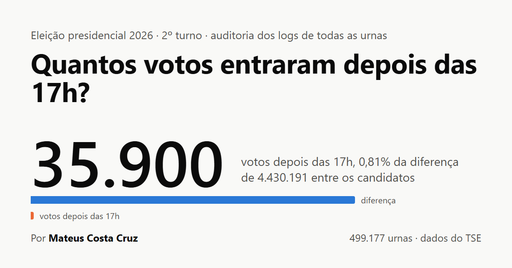

# Auditoria: votos depois das 17h no 2º turno de 2026

Quantos votos foram registrados de 8h a 17h e de 17h a 19h (horário de Brasília) no 2º turno da eleição presidencial de 25/10/2026, e quanto disso, estimado, foi para cada candidato.

Para responder, baixei e li o log de cada uma das 499.177 urnas eletrônicas publicadas pelo TSE e cruzei com o boletim de urna (BU) de cada seção.

**Site com os resultados:** https://auditoria-eleicao-2t-2026.pages.dev



## Resultado

| Faixa (Brasil, horário de Brasília) | Votos | Lula (estimado) | Flávio (estimado) |
|---|---:|---:|---:|
| 8h às 17h | 127.820.283 | 64.037.961 | 59.639.491 |
| 17h às 19h | 34.319 | 18.027 | 15.113 |
| Depois das 19h | 11 | 6 | 4 |
| Sem horário no log | 322 | 163 | 150 |

- Votos depois das 17h, contando o exterior e os votos sem horário: **35.900** (0,028% dos votos).
- Diferença oficial entre Lula e Flávio Bolsonaro: **4.430.191**.
- Pior caso, com todos os votos depois das 17h de cada urna indo para o vencedor: a diferença ainda seria de **4.394.810**.
- 7.353 urnas no Brasil (1,48%) encerraram depois das 17h45.

**Por candidato é estimativa.** O log registra a hora de cada voto, mas não em quem foi o voto (sigilo do voto), e o RDV, que guarda os votos digitados, é embaralhado. Os votos de cada faixa foram distribuídos pela proporção da própria urna. O pior caso não depende dessa estimativa.

## Conferências

- Soma dos 499.205 BUs × resultado oficial do TSE: diferença **zero** em Lula, Flávio, branco, nulo e comparecimento.
- 28 arquivos de BU com SHA-512 igual ao publicado pelo TSE.
- **499.170 urnas** com o número de votos no log exatamente igual ao comparecimento do BU.
- Os 34.330 votos com horário depois das 17h no Brasil batem exatamente com [apolinario/urnas-tardias](https://github.com/apolinario/urnas-tardias) e [Nervado/prorrogacao-2t2026](https://github.com/Nervado/prorrogacao-2t2026). Urna por urna, as 497.882 que estão nas duas análises dão o mesmo número que o apolinario.

### Achados

- **Urna sem log publicado:** Guarulhos (SP), zona 0395, seção 0298. O TSE publicou BU, RDV e assinatura, mas não o log. Os 268 votos entram como "sem horário".
- **Dois logs no mesmo pacote:** Santa Maria de Jetibá (ES), zona 0009, seção 0085. O pacote traz também o log da seção 0112 (612 votos no log × 308 no BU). Separando por urna, a 0085 tem os 308 votos do BU, todos antes das 17h.
- **Seis urnas com menos votos no log que no BU** (1 a 36 votos; todas fecharam entre 17h01 e 17h08): Ibotirama e Conde (BA), São José de Ribamar (MA), Santa Rita (PB), Parnaíba (PI) e Boa Vista do Incra (RS).
- **Catálogo do Portal de Dados Abertos:** a entrada "Boletim de Urna" de RR aponta para o `.sha512` em vez do `.zip`.
- **Duas seções do exterior fora do CSV de BU** (102 eleitores, sem efeito nos votos): votaram pelo sistema de apuração, sem urna eletrônica.

## Método

- **BU:** `bweb_2t_<UF>_261020260742.zip` do [Portal de Dados Abertos do TSE](https://dadosabertos.tse.jus.br/dataset/resultados-2026-boletim-de-urna), SHA-512 conferido.
- **Logs:** `https://resultados.tse.jus.br/oficial/ele2026/arquivo-urna/3221/`. A lista de seções de cada UF (`config/<uf>/<uf>-p003221-cs.json`, 517.179 seções, das quais 17.931 agregadas) aponta, via `...-aux.json`, para a pasta com o `...-log.jez` (zip com o `logd.dat`).
- **Voto:** evento `O voto do eleitor foi computado` de 25/10/2026. Em urna de contingência o pacote traz mais de um log; todos são lidos e a mesma linha não é contada duas vezes.
- **Fuso:** o log usa a hora local. A votação abre às 8h de Brasília, então a hora mais comum de abertura das urnas de cada município dá o fuso. No exterior, usa-se a hora local (8h–17h locais).
- **Sem horário:** votos do BU que não aparecem no log com horário. Por cautela, contam como depois das 17h no pior caso.
- **Urna estendida:** encerrou depois das 17h45 de Brasília.

## Como reproduzir

Rodei numa VM Ubuntu 24.04 (Oracle Cloud, 1 OCPU, 6 GB), Python 3.12, só com a biblioteca padrão.

```bash
python3 -I scripts/baixar_bu.py        # BUs + conferência do SHA-512            (minutos)
python3 -I scripts/extrair_bu.py       # votos de Presidente por urna + conferência com o oficial
python3 -I scripts/coletar_logs.py     # log de cada urna, ~1 milhão de requisições (~14 h)
python3 -I scripts/analisar.py         # faixas de horário, estimativa e pior caso
python3 -I scripts/gerar_manifesto.py  # SHA-256 de cada log baixado
python3 -I scripts/gerar_dados_site.py # dados do site
```

A coleta limita o ritmo a 20 requisições por segundo, reduz sozinha se o servidor reclamar e continua de onde parou se for interrompida.

## Arquivos

| Caminho | Conteúdo |
|---|---|
| `scripts/` | todo o código |
| `resultados/secoes.csv.gz` | uma linha por urna: faixas de horário, estimativa, pior caso, encerramento, fuso, situação |
| `resultados/por_uf.csv`, `por_municipio.csv`, `por_minuto.csv`, `resumo.json` | agregados |
| `resultados/manifesto_logs.csv.gz` | pasta no TSE e SHA-256 de cada log baixado |
| `resultados/manifesto_bu.csv`, `manifesto_config.csv` | SHA-512 dos BUs e SHA-256 das listas de seções |
| `site/` | o site (HTML estático) |

## Limitações

- O log não diz em quem foi o voto: por candidato e horário, só estimativa e pior caso.
- O horário é o do relógio interno de cada urna.
- Quem estava na fila às 17h vota em qualquer eleição; boa parte dos votos logo depois das 17h é essa fila.
- A análise mede o efeito direto dos votos registrados, não questões jurídicas nem efeitos indiretos da prorrogação.

## Autor

Mateus Costa Cruz · [github.com/Mateusinho28](https://github.com/Mateusinho28)

Auditoria independente, sem vínculo com o TSE, partido ou candidato. Código sob licença MIT; os dados são públicos, do Tribunal Superior Eleitoral.
